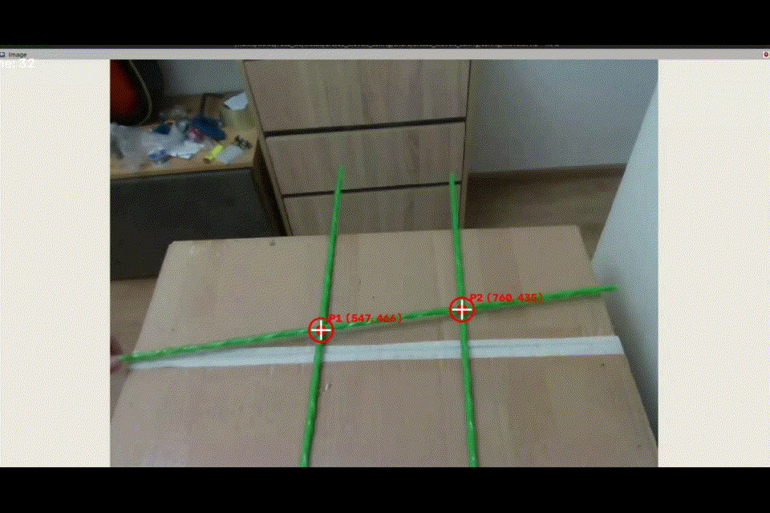
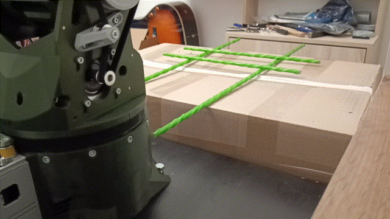
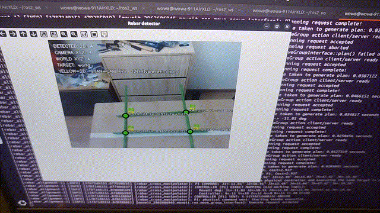
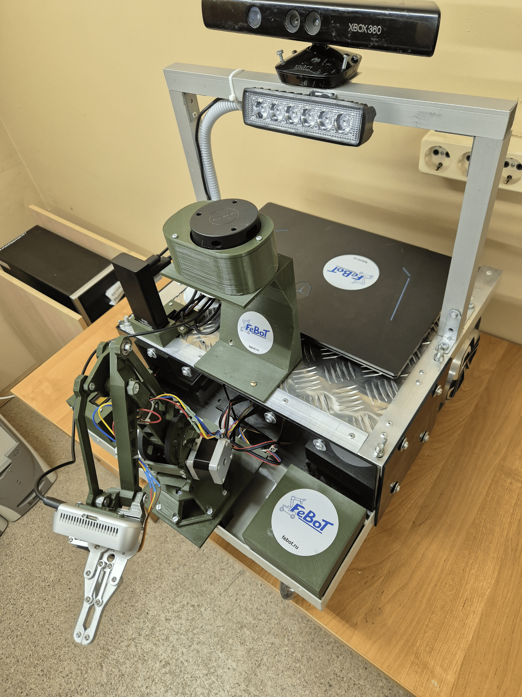
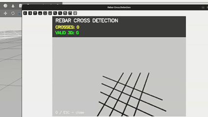
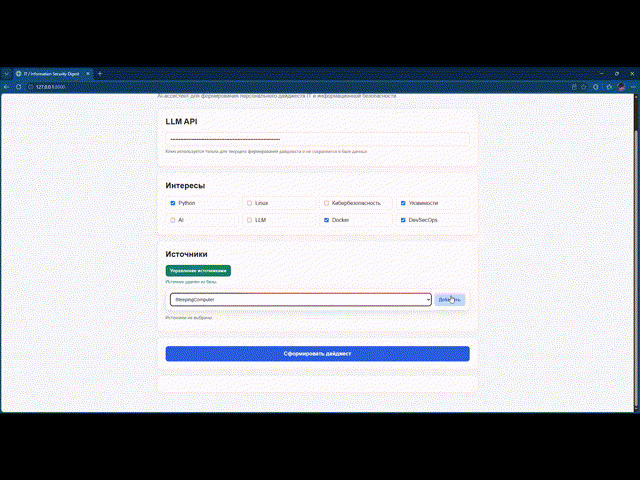

# Mikhail Krakhotin
[English](README.md) | [Русский](README_RU.md)
### Robotics Software Engineer | Machine Learning Engineer | Computer Vision Engineer

I am an engineering student and developer interested in robotics, computer vision, machine learning, and intelligent autonomous systems. My work combines software development, AI, robotic control, and practical engineering.

My main areas of focus are **Python, C++, ROS 2, computer vision, LLMs, and backend development**.

---

## Featured Projects

### 1. Robotic Welding System — Rebar Detection and Manipulation

A robotics project focused on automating operations involving reinforcement bars using computer vision and robotic manipulation.

The system combines camera-based perception, image processing, and ROS 2 to detect reinforcement bars and extract geometric information for further robotic operations.

**Key components:**
- Computer vision for reinforcement bar detection.
- DeepLabV3Plus-based image segmentation.
- Skeletonization and RANSAC for geometric processing.
- Integration with ROS 2 and Gazebo.
- Work with robotic motion planning and manipulation.

**Technologies:** Python, C++, ROS 2 Jazzy, Gazebo Harmonic, OpenCV, DeepLabV3Plus, RANSAC, Intel RealSense D435, MoveIt 2.

  

  
  

---

### 2. FeBot — Mobile Robotic Platform with a Manipulator

A robotic platform project combining mobile robot control, manipulator integration, computer vision, and large language models.

One of the main objectives was to enable a robot to interpret natural-language commands and convert them into sequences of actions. For example, a command such as *"Bring me an apple"* can be decomposed into steps such as locating the object, navigating to it, picking it up, and returning.

**My work included:**
- Developing robotic software and integrating ROS 2 components.
- Working with a mobile platform and a robotic manipulator.
- Training and integrating LLaMA 3.1 8B for natural-language command decomposition.
- Developing computer vision functionality with OpenCV.
- Working with simulation, robot models, and hardware integration.
- Implementing and testing robot navigation and manipulation workflows.

**Technologies:** Python, C++, ROS 2, LLaMA 3.1 8B, OpenCV, Gazebo, RViz, URDF, Linux, Docker.

  

  

---

### 3. IT Security Digest — AI-Powered Cybersecurity News Aggregator

A web application designed to collect cybersecurity news, analyze articles using a large language model, and generate structured digests.

The system collects publications from security-related sources, processes and filters articles, and uses an LLM to summarize content and assess its relevance and importance. The results can be organized into readable reports.

**Key features:**
- Collecting cybersecurity articles from external sources.
- Article processing and duplicate handling.
- LLM-based analysis, classification, and summarization.
- Asynchronous backend operations.
- PostgreSQL database integration.
- Generating structured digests in Markdown and DOCX formats.

**Technologies:** Python, FastAPI, asyncio, SQLAlchemy, PostgreSQL, Alembic, Pydantic, Docker, GigaChat API.

  

---

## Technical Skills

- **Programming:** Python, C++, SQL
- **Robotics:** ROS 2, Gazebo, RViz, URDF, MoveIt 2
- **Computer Vision:** OpenCV, image segmentation, object detection, image processing
- **Machine Learning & LLMs:** LLaMA, Hugging Face Transformers, TensorFlow, scikit-learn
- **Backend Development:** FastAPI, asyncio, Pydantic, SQLAlchemy, REST APIs
- **Databases & Infrastructure:** PostgreSQL, Docker, Linux, Git

---

  <i>Building intelligent systems where software meets the physical world.</i>

